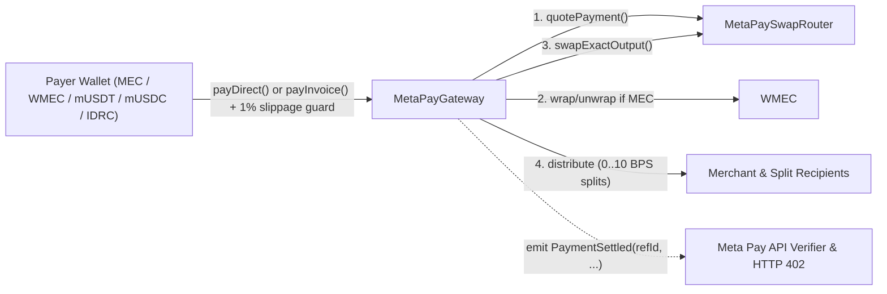

# Meta Pay Smart Contracts

[](https://soliditylang.org/)
[](https://hardhat.org/)
[](https://www.openzeppelin.com/contracts)
[](http://118.175.0.249:8545)

Smart contract suite for **Meta Pay** — a cross-token payment gateway and atomic exact-output settlement protocol built on **Meta Earth Network (ME Network EVM Testnet · Chain ID 400)** for **HARBOR Hackathon · Track 2 (Consumer Products & Payments)**.

---

## Core Capabilities

- **Cross-Token Exact-Output Settlement**: Payers can settle any invoice or HTTP 402 paywall challenge using **MEC** (native), **WMEC**, **mUSDT**, **mUSDC**, or **IDRC**, while merchants deterministically receive their configured settlement token in a single atomic transaction (`payInvoice` / `payDirect`).
- **Multi-Recipient Split Distribution**: Native basis-point splitting up to **10 recipients** (totaling `10,000 bps = 100%`) executed directly on-chain during settlement.
- **Flexible Invoice Expiry**: Supports both **Time-Fixed** (`expiresAt > block.timestamp`) and **No-Limit** (`expiresAt = 0`) invoices, plus creator/owner cancellation before settlement.
- **Replay Protection**: Every settled payment marks `settledPayments[refId] = true` on-chain and emits `PaymentSettled` for deterministic backend verification.
- **Self-Contained Testnet Swap & Faucet Infrastructure**: Includes `MetaPaySwapRouter` (configurable swap fee capped at `500 bps / 5%` and USD reference pricing) and mintable `MockERC20` tokens with public `faucet()` endpoints.

---

## Deployed Contracts (`meTestnet` · Chain ID 400)

- **RPC URL**: `http://118.175.0.249:8545`
- **Deployer**: `0xaa47500F55FCf6b40fb18B036f2B4446A9D510c0`

| Contract | Symbol / Role | Decimals | Deployed Address (`meTestnet`) |
| --- | --- | :---: | --- |
| **MetaPayGateway** | Core Payment & Split Settlement | — | `0xd407227189D8D78E5FcAa61A9B64052A5555DAf6` |
| **MetaPaySwapRouter** | Exact-Output Cross-Token Router | — | `0x66b0F06a3960f31B0C6a7132917fF12cD6e37Eb2` |
| **WMEC** | Wrapped Native Meta Earth Coin | 18 | `0x73bc53fB104CA39E5FBfaf870ed185C94D81893E` |
| **mUSDT** | Meta USDT Testnet Token | 6 | `0x427C9625E57d6c47d2850a2C5366AB094515C2C3` |
| **mUSDC** | Meta USDC Testnet Token | 6 | `0x61F2D51798C9644c9A42BD13fa3f13846B53aac8` |
| **IDRC** | Indonesian Rupiah Coin (`1 USD = 16,000 IDRC`) | 2 | `0xb4d995c522e368360613E913160A1ACF5b1bdb1c` |

Deployment metadata is recorded in `deployments/meTestnet.json`.

---

## Architecture Overview



### Contract Breakdown

| File | Responsibility |
| --- | --- |
| `contracts/MetaPayGateway.sol` | Invoice registry (`createInvoice`, `cancelInvoice`), on-chain quote (`quotePayment`), atomic direct & invoice settlement (`payInvoice`, `payDirect`), native MEC wrapping via `WMEC`, slippage protection, and multi-recipient BPS distribution. |
| `contracts/swap/MetaPaySwapRouter.sol` | Lightweight exact-output swap router backed by owner-configured USD prices (`tokenPriceUsdE18`), swap fee (`swapFeeBps = 30` bps default, capped at `500` bps), and seeded token liquidity. |
| `contracts/swap/ISwapRouter.sol` | Minimal swap router interface consumed by `MetaPayGateway`. |
| `contracts/tokens/WMEC.sol` | Standard WETH-style wrapper (`deposit()` / `withdraw()`) for native `MEC`. |
| `contracts/tokens/MockERC20.sol` | Custom-decimal ERC-20 token with a public `faucet()` method for hackathon/testnet evaluation and owner-only `mint()` for liquidity seeding. |

---

## Project Structure

```text
metapay-smartcontract/
├── contracts/
│   ├── MetaPayGateway.sol
│   ├── swap/
│   │   ├── ISwapRouter.sol
│   │   └── MetaPaySwapRouter.sol
│   └── tokens/
│       ├── MockERC20.sol
│       └── WMEC.sol
├── scripts/
│   ├── deploy.ts           # Deploys tokens, router, seeds liquidity & gateway
│   └── export-abi.ts       # Generates exports/abis.json for metapay-web
├── test/
│   └── MetaPayGateway.test.ts
├── deployments/            # Generated JSON manifests per network
├── exports/                # Generated ABI bundle (abis.json)
├── hardhat.config.ts
├── package.json
└── .env.example
```

---

## Prerequisites & Setup

- **Node.js** `>= 20` and `npm`
- Wallet funded with testnet **MEC** on Chain ID `400` (`> 1 MEC` recommended so `deploy.ts` automatically wraps and seeds `WMEC` into `MetaPaySwapRouter`)

### 1. Install Dependencies

```bash
cd /Users/gadget/Development/metapay/metapay-smartcontract
npm install
```

### 2. Configure Environment

```bash
cp .env.example .env
```

Edit `.env`:

```env
ME_TESTNET_RPC_URL=http://118.175.0.249:8545
DEPLOYER_PRIVATE_KEY=0xYOUR_DEPLOYER_PRIVATE_KEY
```

---

## Commands Reference

| Script | Command | Description |
| --- | --- | --- |
| Compile | `npm run compile` | Compiles all Solidity contracts (`0.8.24`, optimizer `runs: 200`, `viaIR: true`). |
| Test | `npm test` | Runs the Hardhat Mocha/Chai test suite (`test/MetaPayGateway.test.ts`). |
| Deploy (Hardhat) | `npm run deploy:hardhat` | Deploys to ephemeral in-memory Hardhat EVM (`chainId: 31337`). |
| Deploy (Local) | `npm run deploy:local` | Deploys to a running local Hardhat node (`http://127.0.0.1:8545`). |
| Deploy (Testnet) | `npm run deploy:testnet` | Deploys to Meta Earth Testnet (`meTestnet`, `chainId: 400`). |
| Export ABIs | `npm run export-abi` | Writes combined contract ABIs to `exports/abis.json`. |

---

## Running & Deployment Guide

### A. Local Development (Hardhat Node)

```bash
# Terminal 1: Start local EVM node
npx hardhat node

# Terminal 2: Compile, test, and deploy locally
npm run compile
npm test
npm run deploy:local
```

This outputs contract addresses to `deployments/localhost.json`.

### B. Meta Earth Testnet Deployment (`meTestnet`)

```bash
npm run compile
npm test
npm run deploy:testnet
```

`scripts/deploy.ts` performs the full bootstrap automatically:
1. Deploys `WMEC`, `mUSDT` (6 decimals), `mUSDC` (6 decimals), and `IDRC` (2 decimals).
2. Deploys `MetaPaySwapRouter` with `deployer` as owner.
3. Configures initial USD prices (`mUSDT = \$1`, `mUSDC = \$1`, `WMEC = \$0.50`, `IDRC = \$0.0000625`).
4. Mints & seeds router liquidity (`1,000,000 mUSDT`, `1,000,000 mUSDC`, `10,000,000,000 IDRC`, plus `0.5 WMEC` or `10 WMEC` depending on deployer `MEC` balance).
5. Deploys `MetaPayGateway` wired to the router and `WMEC`.
6. Writes the deployment manifest to `deployments/meTestnet.json`.

### C. Syncing with `metapay-web` After a New Deployment

1. Re-export ABIs if contracts changed:
   ```bash
   npm run export-abi
   cp exports/abis.json ../metapay-web/src/core/constants/abis.json
   ```
2. Update the six `NEXT_PUBLIC_*_ADDRESS` entries in `../metapay-web/.env` (and fallback defaults in `../metapay-web/src/core/constants/contracts.ts`) from `deployments/meTestnet.json` or `deployments/localhost.json`.

---

## Security & Compiler Notes

- **Solidity**: `0.8.24` (`optimizer.enabled = true`, `runs = 200`, `viaIR = true`).
- **Guards**: OpenZeppelin `ReentrancyGuard`, `SafeERC20`, and `Ownable` protect payment settlement, ERC-20 transfers, and router governance.
- **Slippage & Fee Caps**: `payInvoice` / `payDirect` enforce `requiredPayAmount <= maxPayAmount`, native `MEC` refunds unused excess automatically, and `MetaPaySwapRouter.setSwapFeeBps` is bounded at `500 bps` (`5%`).
# metapay-smartcontract
